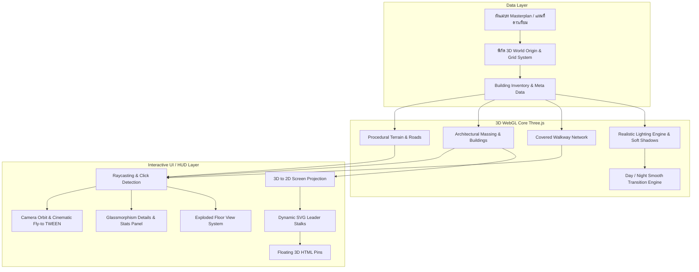

# 🏥 Kamalasai Hospital 3D Smart Building Digital Twin
### โมเดลผังอาคารและระบบควบคุม 3 มิติอัจฉริยะ โรงพยาบาลกมลาไสย จ.กาฬสินธุ์

[](https://threejs.org/)
[](https://developer.mozilla.org/en-US/docs/Web/JavaScript)
[](https://developer.mozilla.org/en-US/docs/Web/HTML)
[](https://developer.mozilla.org/en-US/docs/Web/CSS)
[](LICENSE)

---

## 📌 บทนำและวัตถุประสงค์ (Introduction & Overview)

**Kamalasai Hospital Digital Twin** เป็นโปรเจกต์ต้นแบบการสร้าง **ระบบผังอาคารและศูนย์ควบคุม 3 มิติเสมือนจริง (3D Smart Facility Digital Twin)** บนเว็บเบราว์เซอร์ 100% โดยอิงตามผังแม่บทภาพถ่ายดาวเทียมจริงและแปลนพิมพ์เขียวอาคารของ **โรงพยาบาลกมลาไสย จังหวัดกาฬสินธุ์**

จุดเด่นหลักของสถาปัตยกรรมโปรเจกต์นี้คือ **"ความเรียบง่าย แต่ได้มาตรฐานสูงสุด (Standard & High Performance)"**:
- 🚀 **Zero Heavy 3D Assets**: ไม่ต้องพึ่งพาไฟล์ 3D ภายนอกขนาดใหญ่ (เช่น `.gltf`, `.obj`, `.fbx`) ที่โหลดช้าและกินแบนด์วิดท์
- ⚡ **100% Procedural 3D Geometry**: ตัวอาคาร ถนน ทางเดินเชื่อม และองค์ประกอบทั้งหมดถูกสร้างขึ้นด้วยโค้ดคณิตศาสตร์ (Procedural Code) ผ่าน Three.js โหลดไว แสดงผลทันที ลื่นไหล 60 FPS แม้บนมือถือ
- 🎨 **Architectural Miniature / Clay Diorama Aesthetic**: ดีไซน์สไตล์สถาปัตยกรรมจำลอง สะอาดตา สวยงามแบบโมเดิร์น พร้อมเงาตกกระทบนุ่มนวล (Soft Shadows) และระบบแสงแดดคำนวณตามมุมจริง
- 🌐 **Modern Glassmorphism HUD**: ส่วนติดต่อผู้ใช้แบบกระจกฝ้าโปร่งแสง พร้อมหมุด 3D Pin เชื่อมโยงด้วยเส้น SVG ลอยตามวัตถุในโลกสามมิติแบบเรียลไทม์

---

## 🏗 สถาปัตยกรรมระบบ (System Architecture)



---

## 🚀 จุดเด่นและฟังก์ชันการทำงาน (Key Features)

| ฟีเจอร์ | คำอธิบายเชิงเทคนิค |
| :--- | :--- |
| **3D Masterplan Grid** | จัดวางพิกัดอาคาร 24+ จุดตามแผนที่จริง ทิศทางการจราจรขาเข้า-ขาออก และแนวถนนรอบโรงพยาบาล |
| **Realistic Sun & Shadows** | คำนวณเงาตกกระทบด้วย `THREE.PCFSoftShadowMap` และแถบปรับมุมแดด (Azimuth / Elevation) ปรับแสงเพื่อสำรวจทิศทางแดดจริงได้ทันที |
| **Day / Night Transitions** | สลับบรรยากาศกลางวันและกลางคืน หน้าต่างและป้ายไฟเรืองแสง (Emissive Glow) เสมือนโรงพยาบาลเปิดบริการ 24 ชั่วโมง |
| **Dynamic SVG Leader Stalks** | หมุดป้ายชื่อลอยในโลก 3 มิติ เชื่อมต่อด้วยเส้น SVG แบบ Bezier curve ปรับพิกัดตามมุมกล้องแบบ Real-time |
| **Frontal ER/OPD Focus View** | จุดโฟกัสกล้องเปิดหน้าตึกฉุกเฉิน (ER) และตึกผู้ป่วยนอก (OPD) พร้อมชานชาลารถพยาบาล 1669 ตามมาตรฐานสถาปัตยกรรม |
| **Exploded Floor View** | ระบบแยกชั้นอาคาร 3 มิติ เพื่อดูโครงสร้างฟังก์ชันและผังการใช้งานแต่ละชั้น |
| **Responsive & Fullscreen** | รองรับ Desktop, Tablet, Smartphone พร้อมปุ่มสลับโหมดเต็มจอ (Fullscreen / Hide UI) เพื่อการนำเสนอ |

---

## 🛠 เทคโนโลยีที่ใช้งาน (Technology Stack)

- **Frontend Core**: HTML5 Semantic Structure, Vanilla JavaScript (ES6+)
- **3D Graphics Engine**: [Three.js (r128)](https://cdnjs.cloudflare.com/ajax/libs/three.js/r128/three.min.js)
- **Camera Navigation**: [OrbitControls.js](https://cdn.jsdelivr.net/npm/three@0.128.0/examples/js/controls/OrbitControls.js)
- **Animation Transitions**: [TWEEN.js (18.6.4)](https://cdnjs.cloudflare.com/ajax/libs/tween.js/18.6.4/tween.umd.js)
- **Styling**: Modern Vanilla CSS, Glassmorphism Backdrop Filter, CSS Grid/Flexbox
- **Typography**: Google Fonts (Prompt & Sarabun)

---

## 📖 คู่มือการสร้าง Digital Twin จากศูนย์ (Step-by-Step Developer Guide)

หากคุณต้องการนำแนวคิดของโปรเจกต์นี้ไปพัฒนา Digital Twin สำหรับ **โรงพยาบาล, มหาวิทยาลัย, นิคมอุตสาหกรรม, หรืออาคารสำนักงาน** ของคุณ สามารถทำตาม 6 ขั้นตอนมาตรฐานนี้:

### ขั้นตอนที่ 1: กำหนดจุดกำเนิดและแปลงสเกลผัง (Coordinate Calibration)
1. นำภาพถ่ายดาวเทียม (Google Earth หรือ Drone Mapping) วางเป็นภาพพื้นหลังอ้างอิง
2. กำหนดจุดศูนย์กลางของพื้นที่ **(X: 0, Z: 0)** แนะนำให้ตั้งไว้ที่กึ่งกลางของโครงการ
3. กำหนดอัตราส่วนสเกล เช่น **1 หน่วย Three.js = 1 เมตรจริง**:
   - แกน $+X$: ทิศตะวันออก
   - แกน $-X$: ทิศตะวันตก
   - แกน $+Y$: ความสูงจากพื้นดิน
   - แกน $+Z$: ทิศใต้
   - แกน $-Z$: ทิศเหนือ (หน้าโครงการ / ถนนใหญ่)

### ขั้นตอนที่ 2: สร้างข้อมูลอาคารเชิงโครงสร้าง (Building Inventory Data)
กำหนด Meta Data ของแต่ละอาคารในไฟล์ `main.js`:
```javascript
const HOSPITAL_BUILDINGS = [
  {
    id: "bld-er",
    code: "BLD-ER",
    name: "อาคารอุบัติเหตุฉุกเฉิน & เอ็กซเรย์",
    shortName: "อาคารอุบัติเหตุฉุกเฉิน",
    pos: { x: 17.5, y: 0, z: -39.3 }, // พิกัดในฉาก
    dimensions: { w: 20, h: 8.8, d: 26 }, // กว้าง, สูง, ลึก (เมตร)
    roofColor: 0x4673886,
    accentColor: 0xd32f2f,
    floors: [
      { num: 1, desc: "แผนกอุบัติเหตุและฉุกเฉิน (ER), ชานชาลารถพยาบาล 1669" },
      { num: 2, desc: "งานประกันสุขภาพและยุทธศาสตร์" }
    ]
  }
];
```

### ขั้นตอนที่ 3: ขึ้นรูปทรง 3D แบบ Procedural (Procedural Massing)
การสร้างรูปทรงอาคารด้วยโค้ดทำให้โหลดเร็วและแก้ไขขนาดได้ยืดหยุ่น:
```javascript
// 1. ผนังอาคารหลัก
const wallGeo = new THREE.BoxGeometry(w, h, d);
const wallMesh = new THREE.Mesh(wallGeo, wallMaterial);
wallMesh.position.y = h / 2;
wallMesh.castShadow = true;
wallMesh.receiveShadow = true;

// 2. หลังคาหน้าจั่ว (Gable Roof)
const roofShape = new THREE.Shape();
roofShape.moveTo(-w / 2, 0);
roofShape.lineTo(0, roofHeight);
roofShape.lineTo(w / 2, 0);
roofShape.closePath();

const extrudeSettings = { depth: d, bevelEnabled: false };
const roofGeo = new THREE.ExtrudeGeometry(roofShape, extrudeSettings);
const roofMesh = new THREE.Mesh(roofGeo, roofMaterial);
roofMesh.position.set(0, h, -d / 2);
```

### ขั้นตอนที่ 4: ตั้งค่าระบบแสงเงาระดับสถาปัตยกรรม (Lighting & Tonemapping)
เพื่อให้ภาพออกมานุ่มนวลเหมือนโมเดลสถาปัตยกรรมโมเดิร์น (Architectural Clay Diorama):
```javascript
// 1. เปิดใช้ ACESFilmic Tone Mapping และ Soft Shadows
renderer.shadowMap.enabled = true;
renderer.shadowMap.type = THREE.PCFSoftShadowMap;
renderer.toneMapping = THREE.ACESFilmicToneMapping;
renderer.toneMappingExposure = 0.90;

// 2. แสงแดดส่องทแยงพร้อมขอบเขตเงานุ่ม
const sunLight = new THREE.DirectionalLight(0xfff4e6, 1.65);
sunLight.castShadow = true;
sunLight.shadow.mapSize.width = 2048;
sunLight.shadow.mapSize.height = 2048;
sunLight.shadow.bias = -0.0001;

// 3. แสงกระเจิงท้องฟ้า (Hemisphere Sky/Ground Bounce)
const hemiLight = new THREE.HemisphereLight(0xdce7f2, 0x64748b, 0.45);
```

### ขั้นตอนที่ 5: ฉายพิกัด 3D สู่ป้ายชื่อ HTML (3D to 2D HUD Projection)
เชื่อมโยงจุด Anchor บนหลังคาอาคารเข้ากับป้าย Pin HTML และเส้น SVG:
```javascript
function updateLabelPositions() {
  const tempV = new THREE.Vector3();
  
  labelElements.forEach(({ element, anchorObj }) => {
    anchorObj.getWorldPosition(tempV);
    
    // ฉายพิกัด 3D สู่ Normalized Device Coordinates (-1 ถึง +1)
    tempV.project(camera);
    
    // แปลงเป็นพิกัดพิกเซลบนหน้าจอ
    const x = (tempV.x * 0.5 + 0.5) * window.innerWidth;
    const y = (-(tempV.y * 0.5) + 0.5) * window.innerHeight;
    
    element.style.transform = `translate(-50%, -100%) translate(${x}px, ${y}px)`;
  });
}
```

### ขั้นตอนที่ 6: ระบบมุมกล้องและการเลือกอาคาร (Camera Orbit & Easing)
เมื่อคลิกอาคาร ให้กล้องลอยเข้าไปโฟกัสอย่างนุ่มนวลด้วย TWEEN:
```javascript
new TWEEN.Tween(controls.target)
  .to({ x: targetX, y: targetY, z: targetZ }, 1100)
  .easing(TWEEN.Easing.Cubic.Out)
  .start();

new TWEEN.Tween(camera.position)
  .to({ x: camX, y: camY, z: camZ }, 1100)
  .easing(TWEEN.Easing.Cubic.Out)
  .start();
```

---

## 🤖 Master Prompt สำหรับสั่ง Agentic AI สร้าง Digital Twin (AI Prompt Guide)

ในยุคปัจจุบัน ผู้พัฒนาส่วนใหญ่นิยมใช้ **Agentic AI** (เช่น Google Antigravity, Claude Code, Cursor, Windsurf, GitHub Copilot Workspace หรือ ChatGPT) ในการช่วยเขียนโค้ดและสร้างโปรเจกต์ขึ้นมาอย่างรวดเร็ว 

คุณสามารถ **คัดลอก Master Prompt ด้านล่างนี้** ไปสั่งให้ AI สร้างโปรเจกต์ 3D Digital Twin ที่สมบูรณ์แบบตามแนวคิดและมาตรฐานสถาปัตยกรรมของโปรเจกต์นี้ได้ทันที *(หรือดูไฟล์แยกได้ที่ [plan/AI_DIGITALTWIN_PROMPT.md](plan/AI_DIGITALTWIN_PROMPT.md))*:

<details open>
<summary><b>📋 คลิกเพื่อดู Master Prompt แม่แบบ (Copy-Paste Ready Prompt)</b></summary>

```markdown
คุณคือ Senior Creative 3D WebGL Developer และ Software Architect ที่เชี่ยวชาญ Three.js, Vanilla JavaScript, และ Modern UI Design

เป้าหมายของคุณคือการสร้างเว็บแอปพลิเคชัน "3D Smart Facility Digital Twin Dashboard" แบบ Interactive เสมือนจริง 100% บนเว็บเบราว์เซอร์ โดยจำลองผังอาคาร โครงสร้างสถาปัตยกรรม และระบบควบคุมอัจฉริยะ สำหรับ [ระบุชื่อสถานที่ เช่น โรงพยาบาล... / มหาวิทยาลัย... / โรงงาน...]

โปรดพัฒนาโดยยึดหลักเกณฑ์และสถาปัตยกรรมเชิงเทคนิคมาตรฐานดังต่อไปนี้:

1. ปรัชญาและข้อกำหนดด้านเทคนิค (Core Technical Constraints)
- 100% Procedural Geometry: ห้ามใช้โมเดลไฟล์ 3D ภายนอก (.gltf, .fbx, .obj) เพื่อให้โหลดได้ทันทีแบบ Zero-lag น้ำหนักเบา และแสดงผลลื่นไหล 60 FPS บนทุกอุปกรณ์
- Pure Web Standards: ใช้ HTML5, Vanilla CSS (Glassmorphism), และ Vanilla JavaScript (ES6+) ร่วมกับ Three.js (r128), OrbitControls, และ TWEEN.js ผ่าน CDN โดยไม่ต้องใช้ build tools หรือติดตั้ง npm dependencies
- Aesthetic Style (Architectural Clay Diorama): สุนทรียศาสตร์แบบโมเดลสถาปัตยกรรมจำลอง สะอาดตา ผนังคอนกรีตคลีนโทนสว่างนวล หลังคาตัดสีเอกลักษณ์ประจำอาคาร กระจกสะท้อนเงาคมชัด และขอบอาคารมีมิติ

2. ระบบพิกัดและการจัดผัง (3D Coordinate System)
- กำหนดจุดกึ่งกลางของพื้นที่โครงการเป็น (X: 0, Z: 0) บนระนาบ Y=0 (1 หน่วย Three.js = 1 เมตรจริง)
- แกน +X = ตะวันออก, -X = ตะวันตก, +Y = ความสูง, +Z = ใต้, -Z = เหนือ (หน้าโครงการ / ถนนใหญ่)
- สร้างพื้นดิน (Ground Plinth), ถนนสายหลักยางมะตอย, วงเวียน, ทางเดินเท้า, และสระน้ำ/สวนหย่อม

3. การสร้างอาคารและสิ่งปลูกสร้าง (Procedural Architectural Massing)
สร้างฟังก์ชันการสร้างอาคารด้วย Three.js Code โดยแยกกลุ่มวัตถุ (THREE.Group) และรองรับโครงสร้างแบบเป็นชั้น (Floors Hierarchy):
- Base Massing: ใช้ THREE.BoxGeometry สำหรับผนังและเสา
- Roofs: หลังคาหน้าจั่ว (Gable Roof) ด้วย THREE.ExtrudeGeometry, หลังคาปั้นหยา (Hip Roof), และหลังคาเรียบพร้อมขอบกันตก (Flat Parapet)
- Architectural Details: ซุ้มทางเข้า (Canopy/Portico), ทางลาดรถพยาบาล/รถเข็น (Ramp), ระเบียงยื่น (Balcony), แผงระแนงบังแดด (Louvers), บันได และกระจกหน้าต่างแนวยาว (Ribbon Windows)
- Covered Walkways: โครงข่ายทางเดินมีหลังคาคลุมเชื่อมต่อระหว่างอาคาร พร้อมเสาค้ำคู่เป็นระยะ

4. ระบบแสงเงาและบรรยากาศ (Realistic Lighting Engine)
- Renderer Settings: PCFSoftShadowMap, ACESFilmicToneMapping, Exposure 0.90
- Lighting Setup: THREE.DirectionalLight (แดดสี #fff4e6, Intensity 1.65, Azimuth -40°, Elevation 48° ส่องทแยงเกิดเงาทอดยาวสวยงาม), THREE.HemisphereLight (สกายบาวน์ 0.45), และ Fog เพื่อมิติความลึก
- Day / Night Engine: กลางวันแดดสดใส / กลางคืนท้องฟ้าสีเข้ม แสงจันทร์นวล และกระจกหน้าต่าง/ป้ายไฟปรับ emissiveIntensity เรืองแสงสีทองส้ม 24 ชม.

5. มุมกล้องและระบบควบคุม (Camera & Presets)
- OrbitControls พร้อม Damping (dampingFactor: 0.08), จำกัด maxPolarAngle ป้องกันกล้องมุดลงใต้ดิน
- Startup View: วางตำแหน่งกล้องมองเข้าหา "ด้านหน้าอาคารหลัก" (จากทิศเหนือมองลงทิศใต้) ด้วยมุมกดสถาปัตยกรรม 30°-35° ระยะกำลังพอดีเห็นซุ้มทางเข้า ทางลาด และบริบทแวดล้อม
- ดับเบิลคลิกบนจุดใดๆ ในฉาก: กล้องจะซูมเข้าสู่จุดนั้นอย่างราบรื่น (Smooth Zoom Jump)
- เมื่อคลิกเลือกอาคาร: ใช้ TWEEN.js เคลื่อนกล้อง Orbit เข้าไปโฟกัสด้านหน้าอาคารอย่างนุ่มนวล (Cinematic Easing)

6. ส่วนติดต่อผู้ใช้และหมุด 3D (Interactive HUD & Leader Pins)
- Dynamic 3D Pins & SVG Leader Stalks: สร้างจุด Anchor เหนือหลังคา ฉายพิกัด 3D สู่หน้าจอ 2D (project(camera)) แสดงหมุดป้ายชื่อ HTML ลอยตามอาคาร พร้อมลากเส้น SVG Curve เชื่อมจากตัวอาคารขึ้นสู่หมุดแบบเรียลไทม์
- Modern Glassmorphism UI:
  - Top Bar: โลโก้, ช่องค้นหาอาคาร, นาฬิกาดิจิทัล, ปุ่มปรับแสง, ปุ่มเต็มจอ
  - Detail Slide Panel: แสดงชื่ออาคาร, แผนกบริการ, ผังจำลองแต่ละชั้น, สถิติผู้ใช้งาน, และปุ่มเปิดดูผังแยกชั้น (Exploded Floor View)
  - Bottom Toolbar: ปุ่มรีเซ็ตภาพรวม, ปุ่มหมุน 360° (Turntable), ปุ่มเปิด-ปิดป้ายชื่อ, ปุ่มเปิด-ปิดทางเชื่อม, ปุ่มสลับโหมดกลางวัน/กลางคืน
  - Sun & Light Popover: สไลเดอร์ปรับ Azimuth, Elevation, Sun Power, และปุ่ม Preset แสง (เช้า, เที่ยง, เย็น, ค่ำ)

โปรดส่งมอบโค้ดที่สมบูรณ์ สะอาด มีคอมเมนต์อธิบาย แยกโครงสร้างอย่างเป็นระบบ พร้อมเปิดทำงานผ่านเบราว์เซอร์ได้ทันที!
```
</details>

### 💡 ตัวอย่าง Micro-Prompts สั่งปรับแต่งเพิ่มเติม (Iterative Refinement)

- **เพิ่มอาคารใหม่**:
  ```markdown
  ช่วยเพิ่มอาคารใหม่รหัส BLD-HEMO (ศูนย์ไตเทียม) พิกัด X=28, Z=-15 ขนาดกว้าง 18m สูง 7.5m (2 ชั้น) ลึก 24m หลังคาสีน้ำเงิน มีทางลาดชันสำหรับรถเข็นเชื่อมต่อกับถนนด้านหน้าโดยไม่ล้นทับเลนจราจร
  ```
- **ปรับมุมกล้องเปิดหน้าโครงการ**:
  ```markdown
  โปรดปรับค่าใน VIEW_PRESETS.overview ให้จุดโฟกัสตอนเปิดระบบหันหน้าเข้าหาหน้าตึกหลักจากถนนใหญ่หน้าโครงการ ด้วยมุมกด 32 องศา ระยะห่าง 75 เมตร
  ```
- **เชื่อมต่อ IoT / Live API**:
  ```markdown
  ช่วยเขียนฟังก์ชัน fetchSensorData() ดึงค่าอุณหภูมิและความชื้นมาแสดงบนป้าย 3D Pin และในการ์ดรายละเอียด หากสถานะเป็นฉุกเฉินให้เปิดไฟกะพริบสีแดงบนยอดตึก
  ```

---

## 📁 โครงสร้างโปรเจกต์ (Project Structure)

```text
kmlsfloor/
├── index.html            # โครงสร้างหน้าเว็บหลักและ UI Overlay
├── style.css             # ตกแต่ง Glassmorphism, แผงควบคุม, และ Responsive Layout
├── main.js               # Logic หลัก: Three.js Scene, Procedural Mesh, แสงเงา และ Event Handlers
├── .gitignore            # ไฟล์คัดกรองสำหรับ Git Repository
├── README.md             # เอกสารแนะนำและคู่มือการพัฒนา
├── plan/
│   └── 1_kmls_3d_building_plan # แผนแม่บทการพัฒนา 3D สถาปัตยกรรมและรายละเอียดมิติ
└── img/
    ├── floor.png         # ภาพแปลนพิมพ์เขียวอาคารอ้างอิง
    ├── maps.png          # ภาพถ่ายทางอากาศมุมกว้าง
    ├── maps2.png         # ภาพถ่ายดาวเทียมความละเอียดสูง (Google Earth Calibrated)
    └── ...               # ภาพสแกนพื้นที่เฉพาะโซน
```

---

## 💻 วิธีการติดตั้งและรันโปรเจกต์ (Getting Started)

เนื่องจากโปรเจกต์นี้พัฒนาด้วย **Pure Vanilla Web Technologies (HTML/JS/CSS)** จึงไม่จำเป็นต้องคอมไพล์หรือติดตั้ง `npm install` ใดๆ ทั้งสิ้น:

### วิธีที่ 1: รันด้วย Python (แนะนำ สะดวกและรวดเร็ว)
```bash
# Clone โปรเจกต์ลงเครื่อง
git clone https://github.com/witsanu-dev/kmls-digitaltwin.git

# เข้าสู่โฟลเดอร์
cd kmls-digitaltwin

# เริ่ม Local HTTP Server ด้วย Python
python -m http.server 8080
```
เปิดเบราว์เซอร์ไปที่: `http://localhost:8080`

### วิธีที่ 2: รันด้วย Node.js (`npx serve` หรือ `http-server`)
```bash
npx serve .
# หรือ
npx http-server -p 8080
```

### วิธีที่ 3: ใช้ VS Code Live Server
1. เปิดโฟลเดอร์โปรเจกต์ด้วย Visual Studio Code
2. ติดตั้ง Extension **Live Server**
3. คลิกขวาที่ไฟล์ `index.html` แล้วเลือก **"Open with Live Server"**

---

## 🎮 คู่มือการควบคุม (User Controls & Keybindings)

- **คลิกซ้าย + ลาก**: หมุนมุมมองรอบโครงการ (Orbit Rotate)
- **คลิกขวา + ลาก**: เลื่อนระนาบมุมมอง (Pan)
- **หมุนล้อเมาส์**: ซูมเข้า - ซูมออกอย่างอิสระ (Smooth Zoom)
- **ดับเบิลคลิกบนจุดใดๆ**: กล้องจะซูมเข้าสู่จุดที่คลิกทันที (Double-Click Jump)
- **คลิกที่อาคาร หรือ ป้ายชื่อ**: โฟกัสอาคาร เปิดแผงรายละเอียด และสถิติข้อมูล
- **กดปุ่ม `H` หรือปุ่ม "เต็มจอ"**: สลับโหมดเต็มจอ / ซ่อนแถบควบคุมเพื่อการนำเสนอ
- **กดปุ่มโลโก้โรงพยาบาล**: รีเซ็ตมุมมองกลับสู่จุดมาตรฐานหน้าตึก ER/OPD

---

## 🤝 การนำไปประยุกต์ใช้และต่อยอด (Adaptation & Extensions)

คุณสามารถนำโปรเจกต์นี้ไปต่อยอดในบริบทต่างๆ ได้อย่างง่ายดาย:
1. **IoT Sensor Integration**: ดึงข้อมูลอุณหภูมิ, คุณภาพอากาศ (PM2.5), หรือสถานะการใช้ไฟฟ้าผ่าน WebSocket/REST API แล้วแสดงผลบนอาคารแบบ Real-time
2. **CCTV Live Preview**: ผูกตำแหน่งกล้องวงจรปิด 3D เข้ากับหน้าต่างสตรีมภาพสด
3. **Emergency Navigation**: จำลองเส้นทางหนีไฟ หรือเส้นทางนำส่งผู้ป่วยฉุกเฉิน
4. **Energy Management (BEMs)**: แสดงความร้อนของอาคาร (Heatmap) อิงตามการใช้พลังงานแอร์และไฟฟ้า

---

## 👨‍💻 รายละเอียดผู้พัฒนา (Developer & Author)

<div align="center">
  <h3>นายวิษณุ ศรีโยธา (wITsaNU _<)</h3>
  <p><b>นักวิชาการคอมพิวเตอร์ · กลุ่มงานสุขภาพดิจิทัล</b></p>
</div>

| ข้อมูล (Field) | รายละเอียด (Details) |
| :--- | :--- |
| **ผู้พัฒนา (Developer)** | **นายวิษณุ ศรีโยธา** (`wITsaNU _<`) |
| **ตำแหน่ง (Position)** | นักวิชาการคอมพิวเตอร์ |
| **กลุ่มงาน (Department)** | กลุ่มงานสุขภาพดิจิทัล |
| **หน่วยงาน (Organization)** | โรงพยาบาลกมลาไสย จังหวัดกาฬสินธุ์ |
| **ต้นสังกัด (Affiliation)** | สำนักงานสาธารณสุขจังหวัดกาฬสินธุ์ เขตสุขภาพที่ 7 กระทรวงสาธารณสุข |
| **GitHub** | [https://github.com/witsanu-dev](https://github.com/witsanu-dev) |

---

## 📄 ลิขสิทธิ์ (License)

โปรเจกต์นี้เผยแพร่ภายใต้ใบอนุญาต **[MIT License](LICENSE)** สามารถนำไปศึกษา ดัดแปลง ใช้งาน และพัฒนาต่อยอดได้อย่างอิสระ

---

<div align="center">
  พัฒนาเพื่อเป็นวิทยาทานและต้นแบบระบบดิจิทัลทวินสำหรับองค์กรไทย<br>
  <b>กลุ่มงานสุขภาพดิจิทัล · โรงพยาบาลกมลาไสย จ.กาฬสินธุ์</b>
</div>
